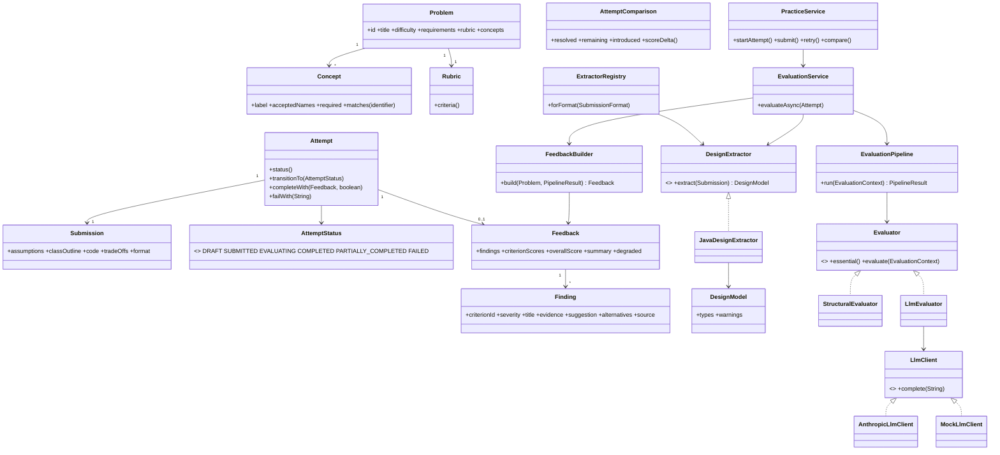

# LLD Practice Platform

[](https://github.com/KpradeepKumar25/LLD_Practiceproblem-cipher_School-/actions/workflows/build.yml)

A focused MVP that lets a learner pick a Low-Level Design problem (Parking Lot, Elevator
System, Vending Machine), design a solution, submit it, and get explainable, rubric-based
feedback — then try again and see whether they actually improved.

```
Choose problem -> Think / design -> Submit -> Get feedback -> Review -> Try again
```

## Why this exists

LLD practice is easy to start and hard to self-evaluate: you can design a Parking Lot and still
not know whether your abstractions, responsibilities and extensibility are actually good, because
there isn't one correct answer to compare against. This platform evaluates the *design itself*
(structure, abstraction, responsibilities, encapsulation) with deterministic rules, and uses an
LLM only for the parts that genuinely need judgement (whether responsibilities are well placed,
whether the stated trade-offs hold up) — see `docs/DESIGN_NOTE.md` for the full reasoning.

## Features

- **3 problems** (Parking Lot, Elevator System, Vending Machine) with requirements, "think
  first" prompts, hints, and a rubric of expected design concepts.
- **Structured submissions**: assumptions, class outline, code, and trade-offs — not one text box.
- **Deterministic structural review**: a tolerant Java parser extracts a format-neutral design
  model (types, methods, fields, supertypes, instanceof/switch usage, dependencies) and a
  rule-based evaluator checks requirement coverage, abstraction usage, single responsibility,
  extensibility, encapsulation and reasoning quality — always reproducible, never the AI's opinion.
- **Optional AI review** on top: judges responsibility placement, abstraction choices and
  trade-off reasoning. Works with **zero configuration** via an offline heuristic reviewer; set
  `ANTHROPIC_API_KEY` to use the real model instead.
- **Multiple valid solutions, not one model answer**: expected design concepts (e.g. "a parking
  spot") accept several names (`Spot`, `Slot`, `Bay`, ...). Two Parking Lot sample solutions with
  completely different structure (interfaces vs. an abstract class + records) both score 100, and
  a weak/strong pair for Vending Machine repeats the same proof on a second problem.
- **Attempt lifecycle**: Draft → Submitted → Evaluating → Completed / Partially completed / Failed,
  with retry from a failed or partial attempt.
- **History & comparison**: every attempt is kept; "Compare with previous" shows which
  deterministic issues were resolved, which remain, and which are new.
- **Server-rendered web UI** (no frontend framework) plus a small read-only JSON API.

## Quick start

No API key needed. Requires Java 17+ and Maven. CI (`.github/workflows/build.yml`) runs the full
test suite and builds the jar on every push, so `main`/`master` is always known to build clean.

```bash
# Windows (PowerShell / cmd)
mvnw.cmd test
mvnw.cmd package
java -jar target\lld-practice-platform-jar-with-dependencies.jar

# macOS / Linux
./mvnw test
./mvnw package
java -jar target/lld-practice-platform-jar-with-dependencies.jar
```

(If you don't have a Maven wrapper set up, substitute your own `mvn` for `mvnw`/`./mvnw` — a
plain `mvn test` / `mvn package` works the same way with a system-installed Maven 3.6+.)

Then open **http://localhost:8787/problems**. From the Parking Lot problem page, use the
"prefill a weak example" / "a strong example" links to see the full loop in under a minute
without typing anything.

### Demo script (~3 minutes)

1. Open a Parking Lot problem, click **prefill a weak example**, then **Submit for feedback**.
   Watch it score poorly with specific findings: a god class, public mutable fields, an
   instanceof chain, a missing `Ticket` concept.
2. Click **Try again** — it opens a new draft prefilled from the weak attempt. Click
   **prefill a strong example (Strategy interfaces)** instead (or hand-edit the weak one) and
   submit.
3. On the new attempt's result page, click **Compare with previous** — see exactly which issues
   were resolved and the score delta.
4. Open **/problems/parking-lot/prefill/good-b** directly to see the *other* strong sample
   (abstract class + records, different names for the same concepts) also score well — proving
   the platform isn't matching a single model answer.

## Configuration

| Env var | Default | Purpose |
|---|---|---|
| `PORT` | `8787` | HTTP port the server listens on |
| `ANTHROPIC_API_KEY` | unset | When set, AI review calls the real Anthropic API |
| `ANTHROPIC_MODEL` | `claude-sonnet-5-5` | Overrides the model used for AI review |

With no `ANTHROPIC_API_KEY`, AI review runs through `MockLlmClient`, a clearly-labelled offline
heuristic — the app is fully functional, just without real AI judgement on responsibility
placement and reasoning quality.

## Project structure

```
src/main/java/lldpractice/
  domain/       Problem, Concept, Rubric, Submission, Attempt (+ state machine), Finding,
                Feedback, AttemptComparison, typed exceptions
  design/       DesignModel + JavaDesignExtractor (tolerant parser) + ExtractorRegistry
  evaluation/   Evaluator (Strategy), StructuralEvaluator (deterministic), LlmEvaluator,
                LlmClient (Anthropic / Mock), PromptBuilder, EvaluationPipeline (Composite),
                FeedbackBuilder
  repository/   ProblemRepository / AttemptRepository interfaces + in-memory and
                JSON-file implementations
  service/      PracticeService (attempt lifecycle), EvaluationService (async evaluation)
  catalog/      The 3 problems + hand-written weak/strong sample submissions
                (Parking Lot: 3 samples; Vending Machine: 2 samples)
  web/          Hand-rolled router, HTML page handlers, JSON API, HttpServer wiring
  util/         Json (dependency-free JSON read/write)
  App.java      Composition root / main()
src/test/java/  Mirrors the structure above
docs/           RESEARCH_NOTE.md, DESIGN_NOTE.md
AI_USAGE.md     AI-assisted decisions made while building this
```

## Class diagram (core domain + evaluation)



## Key decisions

- **No Spring, no JSON/ORM library.** `com.sun.net.httpserver.HttpServer` plus a ~30-line hand
  rolled router and a ~250-line `Json` class keep the whole app dependency-free except JUnit.
  For an app this size it's less code than wiring a framework, and it's one less thing to explain
  in review.
- **Concepts accept multiple names, on purpose.** The single biggest risk for an LLD evaluator is
  anchoring on one model answer. `Concept.matches()` does substring matching against a list of
  accepted names, and the two Parking Lot "strong" samples deliberately use different vocabulary
  and structure (interfaces vs. abstract class + records) to prove this works — see the tests in
  `SampleSubmissionsTest`.
- **Deterministic rules are essential; the LLM is advisory.** If `StructuralEvaluator` throws, the
  attempt fails — the rules are the floor every attempt can rely on. If the LLM call fails or times
  out, the attempt still completes as `PARTIALLY_COMPLETED` with deterministic feedback and a
  clear note, never silently degraded.
- **The learner is just a name in a cookie.** No auth, as the brief scopes it out; good enough to
  demonstrate "history per learner."

## Limitations

- The Java "parser" is a tolerant, regex/brace-matching extractor, not a real compiler front end.
  It's deliberately lightweight (see `docs/DESIGN_NOTE.md`). One known, tested limitation:
  multiple fields declared on one line (`public int a, b, c;`) are read as a single field rather
  than three (`JavaDesignExtractorTest.multipleFieldsDeclaredOnOneLineAreAKnownLimitation`) —
  undercounts `fieldCount` slightly on a style most submissions don't use, without corrupting
  anything else the evaluator relies on.
- Only Java submissions are supported today; `ExtractorRegistry` is the seam for adding another
  format (e.g. a diagram) without touching any evaluator.
- Attempts are in-memory by default (`InMemoryAttemptRepository`) and are lost on restart.
  `JsonFileAttemptRepository` is a second, fully-working implementation kept specifically to prove
  the Repository interface buys swappability — wiring it in instead is a one-line change in `App`.
- Rate limiting, auth, and multi-node deployment are explicitly out of scope per the brief.
